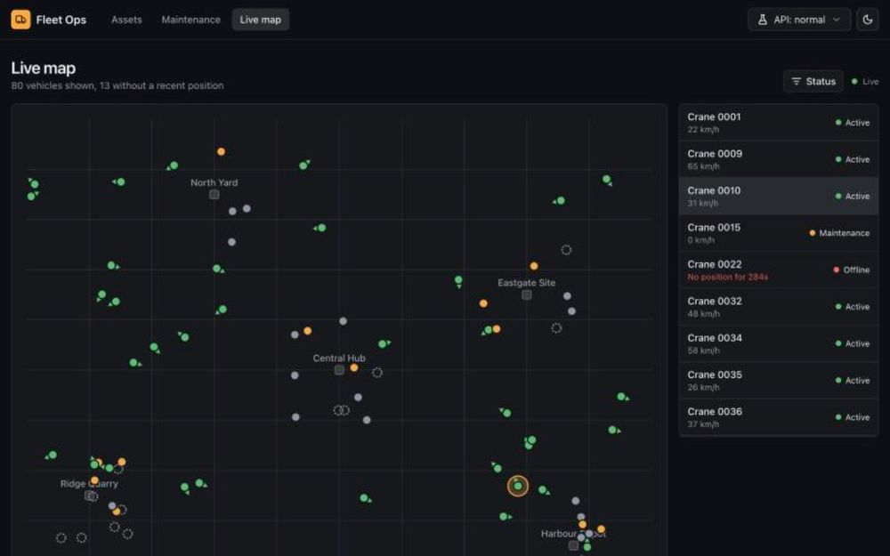
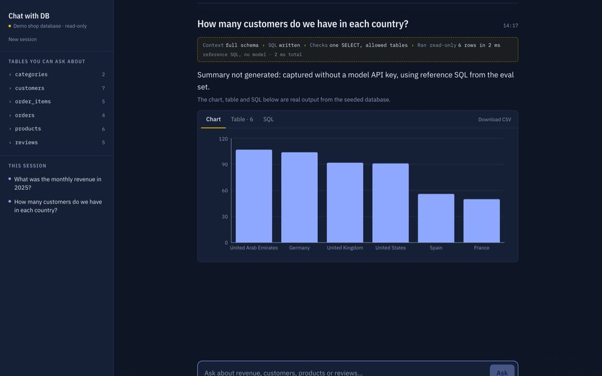
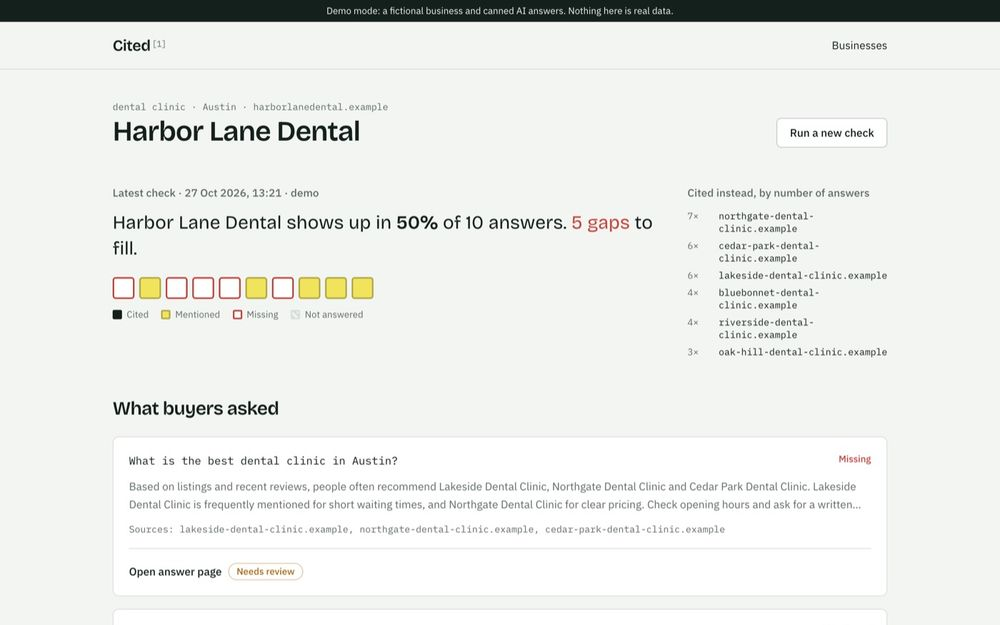
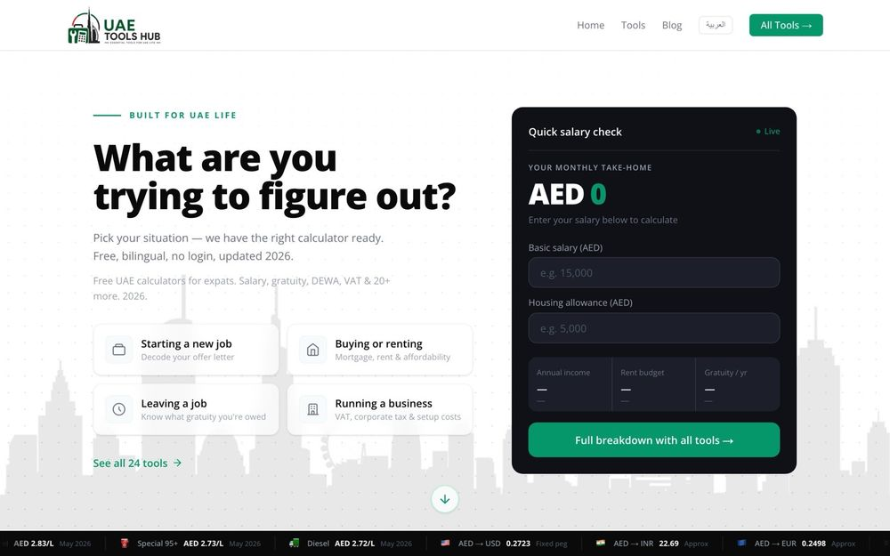
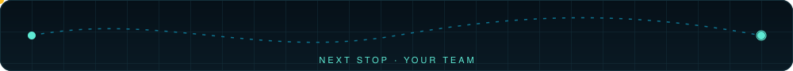

<div align="center">

<a href="https://usamakhaki.com"></a>

<a href="https://usamakhaki.com"></a>

<a href="https://usamakhaki.com"></a>
<a href="https://www.linkedin.com/in/usamakhaki"></a>
<a href="mailto:khakiu.uk@gmail.com"></a>


</div>

## About

I design frontends for data-heavy SaaS and build the services behind them. Since May 2016 I've worked across React, Next.js, TypeScript, Node.js and Laravel. Most recently I've been leading frontend architecture and a team of three at **TENDERD**, an equipment and fleet management platform.

What I care about: interfaces that stay fast with thousands of rows, state that survives a flaky network, and AI features that are checked before they reach a user.

## Live work

<table>
<tr>
<td width="50%" valign="top">
<a href="https://fleet-ops-mu.vercel.app"></a>
<h3>Fleet Ops Dashboard</h3>
Micro-frontends, 5,000-row virtualised tables, optimistic updates and a live WebSocket map.<br><br>
<a href="https://fleet-ops-mu.vercel.app"></a>
<a href="https://github.com/UsamaKhaki/fleet-ops-dashboard"></a>
</td>
<td width="50%" valign="top">
<a href="https://github.com/UsamaKhaki/chat-with-db"></a>
<h3>Chat with DB</h3>
Plain-English questions over Postgres, answered with SQL that is parsed, allow-listed and run read-only.<br><br>
<a href="https://github.com/UsamaKhaki/chat-with-db"></a>
</td>
</tr>
<tr>
<td width="50%" valign="top">
<a href="https://cited-gold.vercel.app"></a>
<h3>Cited</h3>
AI-drafted pages that must pass a 20+ rule quality gate, on Supabase with row-level security.<br><br>
<a href="https://cited-gold.vercel.app"></a>
<a href="https://github.com/UsamaKhaki/cited"></a>
</td>
<td width="50%" valign="top">
<a href="https://uaetoolshub.com"></a>
<h3>Tools Hubs</h3>
Salary and tax calculators for four countries in two languages, with the rules pinned by tests.<br><br>
<a href="https://uaetoolshub.com"></a>
</td>
</tr>
</table>

<details>
<summary><b>More live demos</b> &nbsp;·&nbsp; Ledger, Flyt, Postpilot, Waypoint</summary>
<br>

| Project | What it shows | Links |
| :-- | :-- | :-- |
| **Ledger** | Month-by-month debt payoff simulation with avalanche and snowball strategies | [Live](https://ledger-eta-teal.vercel.app) · [Code](https://github.com/UsamaKhaki/ledger-core) |
| **Flyt** | Flight metasearch behind a swappable provider interface, in a Turborepo monorepo | [Live](https://flyt-beryl.vercel.app) · [Code](https://github.com/UsamaKhaki/flyt) |
| **Postpilot** | LinkedIn posts drafted in your voice and scheduled, published only after you approve them over WhatsApp | [Live](https://postpilot-ten-liard.vercel.app) · [Code](https://github.com/UsamaKhaki/postpilot) |
| **Waypoint** | Keyboard-driven Chrome new tab for developers: PRs, bookmarks and snippets behind Cmd+K | [Website](https://usamakhaki.github.io/waypoint-chrome-ext/) · [Code](https://github.com/UsamaKhaki/waypoint-chrome-ext) |

</details>

### In production

<table>
<tr>
<td align="center" width="25%"><a href="https://downloadvideo.cc"></a><br><b>downloadvideo.cc</b><br><sub>10K+ monthly visitors</sub></td>
<td align="center" width="25%"><a href="https://www.compressimages.cc"></a><br><b>CompressImages</b><br><sub>45 PDF and image tools</sub></td>
<td align="center" width="25%"><a href="https://www.wmeet.cc"></a><br><b>W-Meet</b><br><sub>Video meetings in the browser</sub></td>
<td align="center" width="25%"><a href="https://www.temporaryemail.cc"></a><br><b>Temp Mail</b><br><sub>Disposable inboxes</sub></td>
</tr>
</table>

## Route so far

```text
2023 ─ now    Senior Software Engineer · TENDERD
              Frontend architecture for fleet and equipment SaaS
              Team of 3 · single-spa micro-frontend migration

2021 ─ 2023   Full Stack Developer, Team Lead · TNC IT Solutions Group
              Real Research app, 1M+ downloads
              NestJS services for 100K+ daily users

2018 ─ 2021   Full Stack Developer · HousekeepingCo. Tadbeer
              Enterprise hiring platform · 30+ CRM, HRM and ERP modules

2016 ─ 2018   Web Developer · LAMPDO
              Full-stack Laravel and PHP applications
```

## Toolbox

<p align="center">
<br>
<br>

</p>

<p align="center"><sub><b>AI</b> &nbsp;OpenAI and Claude APIs · LangChain · pgvector · evals &nbsp;&nbsp;|&nbsp;&nbsp; <b>Data UI</b> &nbsp;TanStack Query and Table · WebSockets · Zustand</sub></p>

## Activity

<picture>
  <source media="(prefers-color-scheme: dark)" srcset="https://raw.githubusercontent.com/UsamaKhaki/UsamaKhaki/output/fleet-snake-dark.svg">
  <source media="(prefers-color-scheme: light)" srcset="https://raw.githubusercontent.com/UsamaKhaki/UsamaKhaki/output/fleet-snake.svg">
  
</picture>

<div align="center">
<br>
<a href="mailto:khakiu.uk@gmail.com"></a>
</div>
